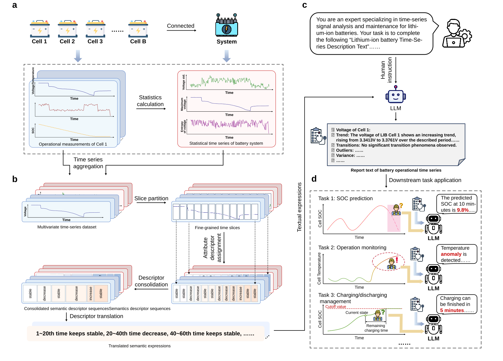

<div align="center">

# TimeSeries2Report prompting enables adaptive large language model management of lithium-ion batteries

_This is the official implementation of **TimeSeries2Report (TS2R)** in the paper "TimeSeries2Report prompting enables adaptive large language model management of lithium-ion batteries"_
[](https://doi.org/your-paper-doi-here)
[](https://www.python.org/)
</div>

<p align="center">
⚡ &nbsp;<a href="#-key-features">Key Features</a>
| &nbsp;<a href="#-TS2R-framework">Framework</a>
| &nbsp;<a href="#-result-video">Result Video</a>
| &nbsp;<a href="#-quick-start">Quick Start</a>
| &nbsp;<a href="#-citation">Citation</a>
</p>

---
## ⚡ Key Features
✅ **Zero-shot time-series analysis** - Enables LLMs to interpret battery data without retraining  
✅ **Semantic enrichment** - Converts raw sensor data into structured natural language reports  
✅ **Multi-task support** - SOC prediction, anomaly detection, and charge management  
✅ **Expert-level performance** - Achieves >90% factual accuracy in benchmark tests  
✅ **Model-agnostic** - Works with diverse LLMs (Qwen, DeepSeek, ChatGLM, Llama)  
✅ **No training required** - Lightweight and ready for deployment  

**TS2R-integrated LLMs achieve expert-level decision quality without model retraining or architecture modification, establishing a practical path for adaptive LLM-driven battery intelligence.**

---

## TS2R Framework
The TimeSeries2Report framework bridges low-level sensor signals with high-level contextual insights through:
1. **Time-series Segmentation**  
   Splits time-series into 10-timestamp slices and extracts temporal attributes  
   ```python
   # Pseudo-code for segmentation
   segments = [data[i:i+window] for i in range(0, len(data), step)]
   ```
2. **Descriptor Assignment**
   Converts numerical features to descriptors (e.g., “increasing”, “stable”) using rule-based mapping
   Trend: increasing → “Voltage shows steady upward progression”
   
3. **Report Synthesis**
   LLM integrates descriptors into coherent operational reports
Prompt:
"You are a battery expert. Describe cell behavior based on: ..." (see `prompting_engineering.py` for details)


<p align="center"><em>Figure: TS2R framework architecture</em></p>

## Result Video

### 1. Report Generation
TS2R can automatically process your input time-series data to generate descriptive reports.

https://github.com/user-attachments/assets/063b5f5f-3104-4f68-9b73-df1e02c9814d

### 2. Battery downstream task practice
The generated reports enable the battery downstream task practice using the simple conversation with LLMs.

https://github.com/user-attachments/assets/dcdf95a9-672c-4d81-9ce5-ef2fb9474b67

<small>You can experience chatting with TS2R using our app! For usage details, please refer to `readme_for_app` in the `TS2R_APP` folder.</small>

## Quick Start

### 1. Install Dependencies

```bash
pip install -r requirements.txt
```

### 2. Configure API Access
#### 2.1. Remote API calls
If you do not have a deployed LLM on your device, you can utilize API calls from mainstream providers such as [DeepSeek](https://platform.deepseek.com/api_keys) and [Qwen](https://bailian.console.aliyun.com/?spm=5176.12818093_47.aillm.1.3be92cc9v6vQfH&tab=model&scm=20140722.S_%E5%9C%A8%E5%93%AA%E9%87%8C%E8%83%BD%E8%8E%B7%E5%8F%96%E9%98%BF%E9%87%8C%E4%BA%91%E7%99%BE%E7%82%BC%E5%B9%B3%E5%8F%B0%E7%9A%84APIkey._.RL_%E5%9C%A8%E5%93%AA%E9%87%8C%E8%83%BD%E8%8E%B7%E5%8F%96%E9%98%BF%E9%87%8C%E4%BA%91%E7%99%BE%E7%82%BC%E5%B9%B3%E5%8F%B0%E7%9A%84APIkey-LOC_aillm-OR_chat-V_3-RC_llm#/model-market).

#### 2.2. Local API calls
For local API calls, make sure that you have deployed the large model on the server. You need to set up the corresponding API interface by running the `API.py` script.
```bash
python your_file_path/API.py
```

### 3. Prepare Datasets

Place battery time-series data in `./time_series_data` directory.

### 4. Battery time-series report generation through simple API call

If utilizing remote API calls, run `TS2R_generation_main.py` with the following parameter settings:

```python
# set utilized LLM
llm_list = ['qwen3-14b', 'qwen3-32b', 'qwen3-235b-a22b-instruct-2507', 'deepseek-chat', 'glm-4.5']
OPENAI_MODEL = llm_list[0] 

# set TOTAL_CNT (line 281) to decide the processing and generation number of time-seires reports
TOTAL_CNT = 100 

# revise the data reading method (lines 285~288) according your own data format (task JSONL file as example) 
dataset_name = "anomaly_data.jsonl"
dataset = PreprocessedDataset(dataset_name)
data_v_win_train, data_c_win_train = prre.read_data_from_json(dataset)
# size of data_v_win_train: (sequence_length, variable_num, battery_num)
# size of data_c_win_train: (sequence_length, 1) (for shared-variable like current for series-connected batteries)

# set the output path (line 296)
OUTPUT_DATASET = f'{dir_path}\\report_{OPENAI_MODEL}_zju_{TOTAL_CNT}_{timestamp[:8]}.jsonl'
```

If employing local API calls, run `TS2R_generation_local_main.py` with the following parameter settings:

```python

# set TOTAL_CNT (line 333) to decide the processing and generation number of time-seires reports
TOTAL_CNT = 100 

# revise the data reading method (lines 336~338) according your own data format (task JSONL file as example) 
dataset_name = "anomaly_data.jsonl"
dataset = PreprocessedDataset(dataset_name)
data_v_win_train, data_c_win_train = prre.read_data_from_json(dataset)
# size of data_v_win_train: (sequence_length, variable_num, battery_num)
# size of data_c_win_train: (sequence_length, 1) (for shared-variable like current for series-connected batteries)

# set the output path (line 345)
OUTPUT_DATASET = f'{dir_path}\\report_zju_{TOTAL_CNT}_{timestamp[:8]}.jsonl'
```


### 5. LLM-driven battery downstream task application --- SOC prediction

run `downstream_SOC_prediction.py` with the following parameter settings:

```python
# set utilized LLM
OPENAI_MODEL = "qwen3-14b"

# set the path to save the SOC precition results (lines 123~130)
current_file_path = Path(__file__)
test_set = '20251210'
dir_path = current_file_path.parents[0] / f"downstream_result_{test_set}"

# add the path 
dataset_name = current_file_path.parents[0] / "output_data" / f"report_{OPENAI_MODEL}_zju_100_{test_set}.jsonl"
```

### 6. LLM-driven battery downstream task application --- anomaly detection

run `downstream_anomaly_detection.py` with the following parameter settings:

```python
# set utilized LLM
OPENAI_MODEL = "qwen3-14b"

# set the path to save the SOC precition results (lines 123~130)
current_file_path = Path(__file__)
test_set = '20251210'
dir_path = current_file_path.parents[0] / f"downstream_result_{test_set}"

# add the path 
dataset_name = current_file_path.parents[0] / "output_data" / f"report_{OPENAI_MODEL}_zju_100_{test_set}.jsonl"
```

### 7. LLM-driven battery downstream task application --- charging/discharging management

run `downstream_charge_management.py` with the following parameter settings:

```python
# set utilized LLM
OPENAI_MODEL = "qwen3-14b"

# set the path to save the SOC precition results (lines 123~130)
current_file_path = Path(__file__)
test_set = '20251210'
dir_path = current_file_path.parents[0] / f"downstream_result_{test_set}"

# add the path 
dataset_name = current_file_path.parents[0] / "output_data" / f"report_{OPENAI_MODEL}_zju_100_{test_set}.jsonl"
```

## 🔗 Citation

If you find this code useful for your research, please cite

- [[Jiayang Yang, Chunhui Zhao, Martin Guay, Zhixing Cao. TimeSeries2Report prompting enables adaptive large language model management of lithium-ion batteries. arXiv preprint arXiv:2512.16453, 2025.](https://arxiv.org/abs/2512.16453)]

```BibTeX
@article{yang2025timeseries2report,
  title={TimeSeries2Report prompting enables adaptive large language model management of lithium-ion batteries},
  author={Yang, Jiayang and Zhao, Chunhui and Guay, Martin and Cao, Zhixing},
  journal={arXiv preprint arXiv:2512.16453},
  year={2025}
}
```
